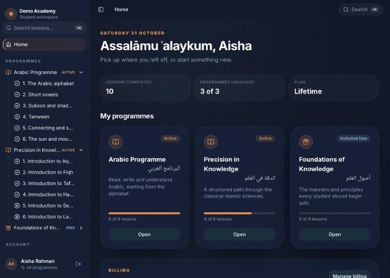
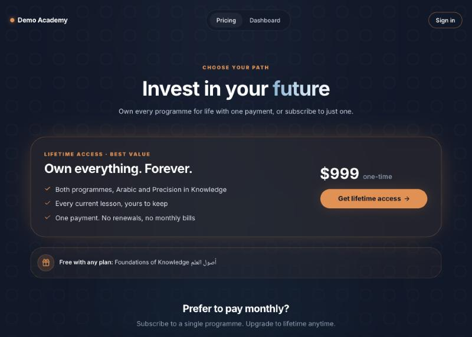
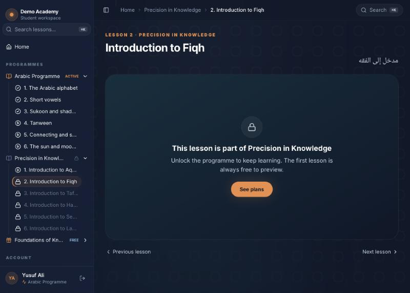
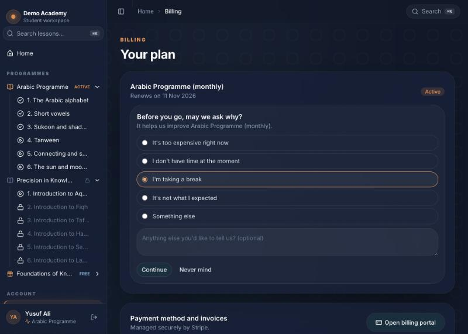
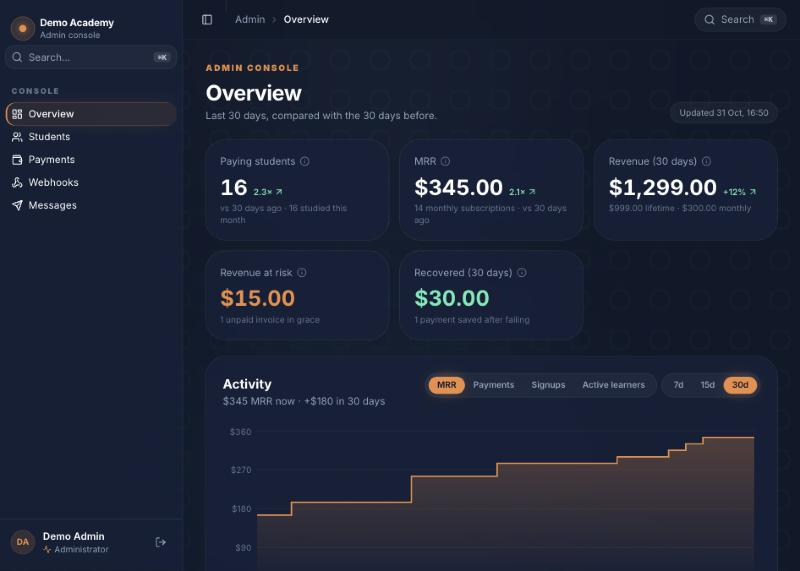
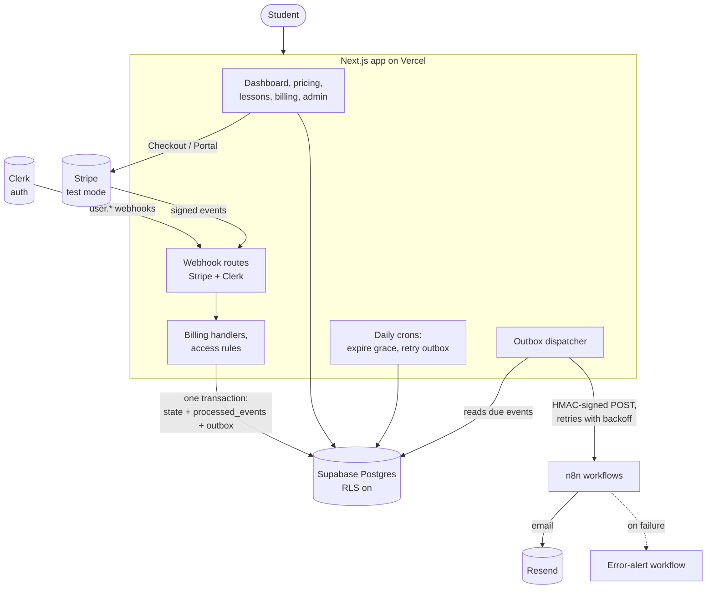
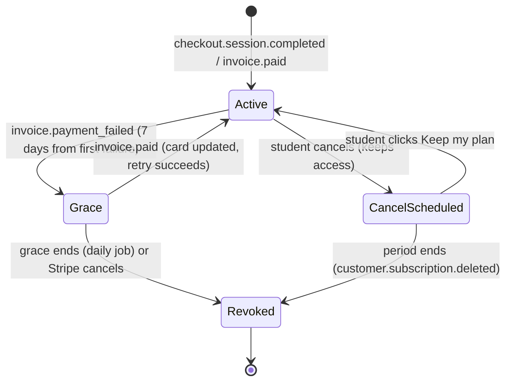
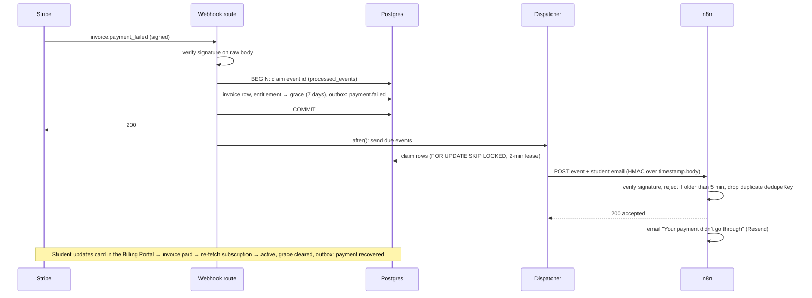
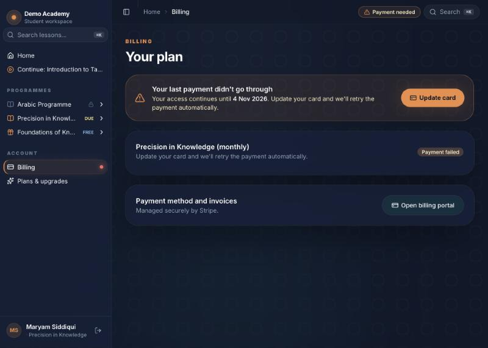

# Academy Access Engine

[](https://github.com/jasirjaleel/academy-access-engine/actions/workflows/ci.yml)

**A student platform for an online Islamic-studies academy: a premium student dashboard on top of a payment, access and messaging engine that stays correct when payments fail, webhooks repeat, and services go down.**

Built as proof of work for the *Full-Stack Developer & Automation Engineer* role at Al-Madrasatu Ar-Raḥmāniyyah (AMAR). It runs under a neutral brand, "Demo Academy", styled to fit AMAR's design language. It's a concept and isn't affiliated with AMAR. Everything runs in **Stripe test mode**.

**Live demo:** https://academy-access-engine.vercel.app (Stripe test mode: pay with card `4242 4242 4242 4242`, any future date, any CVC)



---

## The problem

An academy that sells monthly subscriptions and lifetime access has to get a few unglamorous things exactly right:

- **Access must match payment.** A student who paid sees the lessons; one who didn't, doesn't, including a refund or a cancelled plan.
- **Payments fail.** Most failures are expired cards, not people leaving, so cutting access at once loses loyal students.
- **Webhooks repeat and arrive out of order.** Stripe delivers each event at least once and doesn't guarantee order. A naive handler grants access twice, or lets a stale event overwrite newer state.
- **Every change should reach the student** (welcome, failed payment, recovery, cancellation) exactly once, even if the messaging tool is down for an hour.
- **Someone has to see what's happening**: who is in a grace period, how much revenue was recovered, which messages failed.

## What it does

| Area | Behaviour |
|---|---|
| **Plans** | Arabic $30/month, Precision in Knowledge $15/month, Lifetime $999 one-time. *Foundations of Knowledge* is free with any paid plan. Regional coupon `REGION40`. |
| **Access** | Decided only on the server from an `entitlements` table. A locked lesson never sends its video URL to the browser. The first lesson of each programme is a free preview. |
| **Checkout** | Stripe Checkout. Double purchases are blocked, and a double click can't create two Stripe customers. Access is granted only by the webhook, never by the success page. |
| **Failed payment** | A 7-day **grace period** counted from the *first* failure (retries don't extend it), a banner with "Update your card" (Stripe Billing Portal), automatic restore when paid, and revocation by a daily job when grace runs out. |
| **Cancellation** | Reason → one tailored offer (30% off the next payment, or a 30-day billing pause) → or cancel at period end. Every answer is recorded, each offer is usable once, and "Keep my plan" undoes it. |
| **Refunds** | A full refund of a lifetime purchase revokes exactly what it paid for. Partial refunds change nothing. |
| **Messages** | Every change writes an outbox event in the same transaction. A dispatcher sends it, signed, to **n8n**, which verifies it, drops duplicates and sends the email through Resend. It also nudges students who enrolled 3+ days ago and haven't opened a lesson. |
| **Admin** | Paying students, students in grace, revenue at risk, revenue recovered (30 days), failed payments, a webhook log, and the outbox with **Retry**. |

| Pricing | Locked lesson (no video URL sent) |
|---|---|
|  |  |
| **Cancel flow** | **Admin overview** |
|  |  |

## Architecture



### Access lifecycle of a subscription



### A failed renewal, end to end



## Decisions that matter

Full reasoning in [`docs/DECISIONS.md`](docs/DECISIONS.md).

| # | Decision | Why |
|---|---|---|
| D1 | Access lives in our own `entitlements` table | Fast, works if Stripe is slow, supports lifetime/bundle/manual access, and leaves an audit trail. |
| D2 | Webhook idempotency inside the same transaction as the effects | Stripe delivers at least once; a separate "check, then process" step has a race. A failed attempt is recorded and can be retried. |
| D3 | Re-fetch the subscription instead of trusting the event payload | Stripe doesn't guarantee order; a late event must not overwrite newer state. |
| D4 / D13 | 7-day grace from the *first* failure; the Billing Portal can't cancel | Recover expired cards without punishing students; retries don't quietly add free weeks; cancelling goes through our own flow, which records the reason. |
| D5 / D16 | Outbox → signed webhook → n8n, de-duplicated on both sides | Never send a message for a change that rolled back, never twice, never lost while n8n is down. The copy and channels can change in n8n without a deploy. |
| D9 | Product comes from the price ID, not from metadata | The price is what Stripe actually charged; an unknown price fails loudly and can be retried. |
| D11 | Billing handlers are pure and take Stripe as a dependency | The payment logic runs in tests against a real Postgres with fake Stripe objects, with no network. |
| D12 | Row Level Security on every table, no policies | Supabase exposes tables through its Data API; the app connects as the owner, so this closes the API without affecting the app. |
| D14 | Refunds revoke exactly what they paid for | Access matches money kept; a goodwill partial refund doesn't lock anyone out. |
| D15 | Session pooler and connection timeouts | Found during live testing: page renders hung on the transaction pooler while a server action, a refresh and a webhook overlapped. |

## Tests

**49 tests**, run in CI on every push. They use **PGlite** (real Postgres compiled to WebAssembly) with the **real migrations**, and fake Stripe objects, so no secrets or network are needed.

| File | What it proves |
|---|---|
| `webhooks.test.ts` | A duplicate event runs once; a failed handler rolls back and can be retried. |
| `billing.checkout.test.ts` | Lifetime and subscription grants, the free bundle, duplicates, ignoring unpaid checkouts, stale payloads (D3), unknown prices. |
| `billing.dunning.test.ts` | Grace from the first failure, recovery, normal renewals, late failures for paid invoices, expiry plus bundle removal, idempotent expiry. |
| `billing.cancel-refund.test.ts` | Cancel scheduled once, ended once, pause mirrored, offers once per subscription, full vs. partial refunds. |
| `access.test.ts` | Preview, locked, active, grace before and after expiry, revoked. |
| `progress.test.ts` | A locked student can't write progress; completion is never cleared. |
| `dispatch.test.ts` | Correct HMAC, no personal data stored in the outbox, no double send, backoff timing, giving up after 5 attempts, recovery, deleted students never contacted, inactivity nudge. |
| `admin.test.ts` | Revenue at risk vs. recovered (30-day window), grace counts, outbox and webhook health, retry never re-sends a sent event. |

### Verified live (Stripe test mode, 26 Oct 2026)

- Checkout with the 4242 card → webhook → access unlocked → the success page shows "your access is ready".
- **Failed renewal** using a Stripe *test clock* and the failing card → grace banner → invoice paid → access restored. Every webhook returned 200.
- Cancel flow: 30% offer applied in Stripe, cancel at period end, "Keep my plan", 30-day pause and resume.
- Lifetime bought, then fully refunded → lifetime access revoked, while the separate Arabic subscription kept its access.
- n8n 2.44.7 in Docker: 8 real events delivered; duplicate, tampered and stale requests handled; n8n stopped → retry with backoff → delivered; a failing step triggered the error-alert workflow.



## Tech stack

Next.js 16 (App Router, TypeScript strict) · Tailwind CSS v4 + shadcn/ui · Clerk · Supabase Postgres + Drizzle ORM · Stripe (Checkout, Billing Portal, webhooks, test clocks) · n8n · Resend · Vitest + PGlite · GitHub Actions · Vercel

## Run it locally

```bash
npm install
cp .env.example .env.local            # fill in Supabase, Clerk and Stripe *test* keys
npm run db:migrate && npm run db:seed # tables + 3 programmes, 18 lessons
npx tsx scripts/stripe-setup.ts       # products, prices, coupons, portal config (idempotent)
stripe listen --events checkout.session.completed,customer.subscription.created,customer.subscription.updated,customer.subscription.deleted,invoice.paid,invoice.payment_failed,charge.refunded --forward-to localhost:3000/api/webhooks/stripe
npm run dev
npm test
```

The n8n workflows and their setup are in [`n8n/README.md`](n8n/README.md). Live Stripe keys are refused at startup.

```
src/app/            pages, webhook routes, cron routes, server actions
src/lib/billing/    pure Stripe event handlers (checkout, invoices, refunds, grace, bundle)
src/lib/            access rules, outbox + dispatcher, admin queries, nudges
src/db/             Drizzle schema, client, seed
drizzle/            SQL migrations (incl. RLS)
n8n/                exported workflows + README
tests/              Vitest + PGlite
docs/               architecture, decisions, design system, build log
```

## Known limitations

- **Latency:** the database is in Tokyo. From the UAE, each query is about 350 ms, so actions take several seconds locally. In production the Vercel functions should run next to the database (`hnd1`), or the database should move closer.
- **Alerts use one channel.** If the email provider is what's failing, the email alert can't get out. Production should add Slack or Telegram.
- **No WhatsApp yet.** Meta charges for business-initiated messages, so it was left out. Students' opt-in is still stored, so it can be added as one more n8n branch.
- **Demo emails go to one inbox.** Resend's test sender only delivers to the account owner, so the live n8n sends every student email to a test inbox, with the intended student in the subject.
- **Crons run daily** (Vercel Hobby limit). The first delivery happens immediately after each change, so the daily job is only a safety net.
- Lesson videos are a public CC0 placeholder clip.

## How I built this

I built this in three days with AI coding tools, and I want to be clear about who did what.

- **Me:** I chose the problem from the role description, set the requirements and the milestone plan, made the product decisions (AMAR-style design, real prices, grace length, retention offers, asking students for their name), set up and configured Supabase, Clerk, Stripe and GitHub, ran the live flows in the browser, and decided what to fix when testing found problems.
- **Claude Code (Anthropic)** wrote most of the code, the tests and these docs from that plan, and ran the checks: typecheck, lint, tests, live Stripe test-clock runs and n8n in Docker. The first scaffold step was done with Gemini in Antigravity from a written task prompt.
- **How it was kept honest:** every feature was checked against a real system before moving on. That's how the hung connections on the transaction pooler (D15), a timestamp bug that only appeared on real Postgres, a dead placeholder video, and a lockfile that broke Linux CI were all found and fixed. The reasoning for each choice is in `docs/DECISIONS.md`, and the original task prompts are in `docs/build-log/`.

I can walk through any part of it: why the idempotency claim sits inside the transaction, why grace counts from the first failure, why messages go through an outbox, and what I'd change for production.
